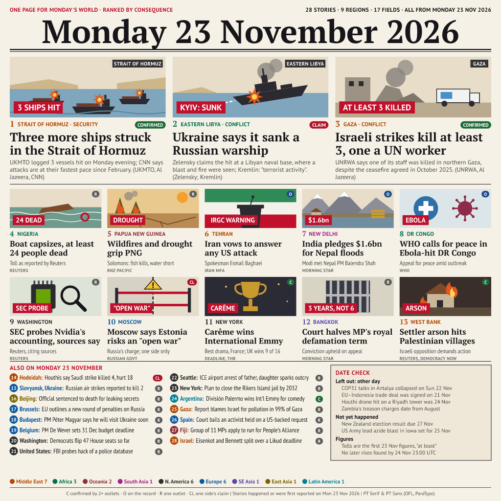

# Monday 23 November 2026, one page

This is an entry for the make.fun bounty [news-image-20261123](https://make.fun/c/news-image-20261123): one 1024×1024 PNG that sums up the world news of Monday 23 November 2026. It holds 28 dated stories from 9 regions, ranked by consequence, and each one carries a source badge (C confirmed, O official, R one outlet, CL one side's claim). A date-check box lists what was left out because it happened on another day.

- `main.ts` is the entry program (Node 22, standard library only). It copies `entry.png` to `/output`.
- `src/content.ts` holds every word and number on the page.
- `build.mjs` draws the page as SVG and rasterises it with `@resvg/resvg-js` (`npm i && node build.mjs`, with the fonts below in `scratch/fonts` or `FONT_DIR`). The same input always gives the same bytes.

**Sources:** UKMTO, Al Jazeera, CNN, Reuters, UNRWA, WHO, Morning Star, Democracy Now, Deadline, The Hollywood Reporter, Times of Israel, RNZ Pacific / PACNEWS, Fiji Sun.

**Fonts:** PT Serif, PT Sans and PT Sans Narrow by ParaType, under the SIL Open Font License 1.1 (from Google Fonts).

Licence: MIT.
